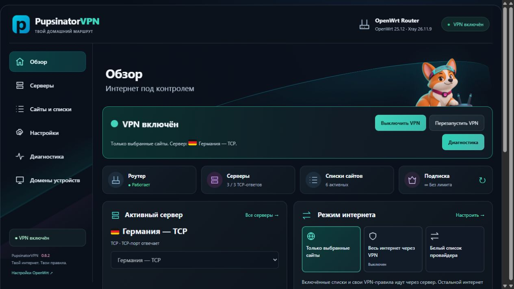
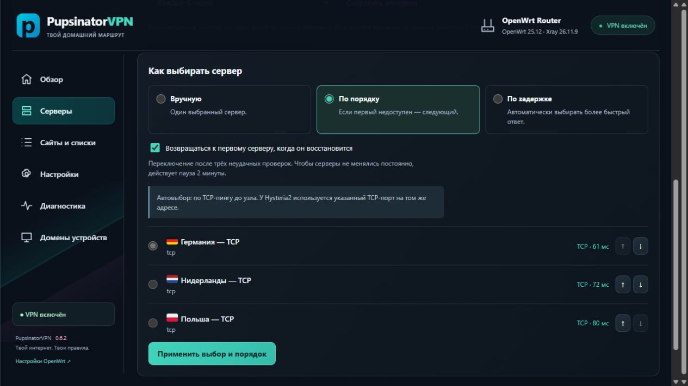
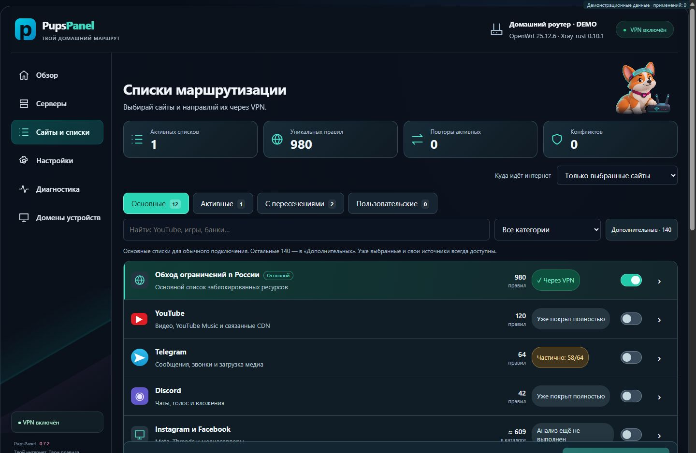

# PupsPanel для OpenWrt

Максимально упрощённый домашний VPN-клиент с собственным интерфейсом и лёгким ядром на основе xray-rust. Он сделан для простого подключения VPN на роутерах с OpenWrt: добавить подписку, выбрать режим и включить. Здесь нет набора сложных настроек и многочисленных дополнительных функций, характерных для универсальных форков.

Программа проверялась в работе **только с одноимённым сервисом PupsinatorVPN**. Работа с другими VPN-сервисами не гарантируется, даже если они используют похожий формат ссылок.

## Интерфейс

Обзор и серверы показаны в прежнем интерфейсе 0.6.4. Списки — компактный интерфейс 0.7.2. Все снимки используют демонстрационные данные: подписки, устройства и показатели вымышлены, это не измерения производительности.







## Установка одной командой

Подключитесь к роутеру по SSH от root:

```sh
wget -O /tmp/pupsinator-install.sh https://raw.githubusercontent.com/pupsinatorvpn/PupsPanel/main/install.sh && sh /tmp/pupsinator-install.sh
```

После установки: **Службы → PupsPanel → Серверы**. Вставьте свою ссылку подписки или отдельную ссылку VLESS/Hysteria2 и включите VPN.

### Если GitHub недоступен

Зеркало: **https://download.pupsinator.ru**. Установка без обращения к GitHub:

```sh
wget -O /tmp/pupsinator-install.sh https://download.pupsinator.ru/install.sh && sh /tmp/pupsinator-install.sh
```

На зеркале размещены тот же установщик, файлы клиента и ядра с теми же контрольными суммами. Загрузки и проверка обновлений сначала используют собственное зеркало, затем GitHub как резерв. Доступность конкретного домена всё равно зависит от сети провайдера.

Подписка и ключи в программу не встроены. На каждом роутере используются настройки его владельца.

## Возможности

- VLESS Reality/TCP, XHTTP с `extra`, WebSocket, gRPC, Hysteria2. Неподдерживаемые параметры вызывают явную ошибку и не заменяют рабочую конфигурацию.
- Подписки, название сервиса, срок и трафик, если провайдер передаёт эти данные.
- Выбранные сайты через VPN, весь интернет через VPN или белые списки напрямую.
- Ручной выбор сервера, приоритеты и выбор по задержке HTTPS-запроса.
- Избранные устройства: весь их внешний IPv4-трафик через VPN одной кнопкой.
- Быстрое переключение сервера, режима интернета и устройств без перезапуска ядра. Общий переключатель на главной меняет цвет и возвращает прежний режим.
- Компактные категории списков, блок «Выбрано», локальный кеш и обновление сначала через VPN.
- Свои списки по HTTPS-ссылке в том же разделе: TXT с доменами/CIDR или исходный JSON rule-set sing-box v3; до 10 источников по 2 МБ.
- Локальный DNS-монитор: домены, устройства и сервисы. Подсказки подтверждает пользователь.
- Настоящие показатели CPU, памяти и температуры, проверка задержки и диагностика.
- Два вида проверки и автовыбора: TCP-пинг до узла или настоящий HTTPS-запрос через VPN. Используется выбранный в настройках способ. TCP-пинг не подтверждает авторизацию VPN; для Hysteria2 проверяется известный TCP-порт того же адреса из подписки, а не UDP-туннель. Если такого порта нет, показана пометка о неприменимости TCP; для проверки UDP выберите HTTPS.
- Обновление из интерфейса; при желании — по выбранному времени МСК.
- Резервная копия перед обновлением, автоматический откат при ошибке, удаление копии после успешной проверки.

## Совместимость 0.7.0

OpenWrt **24.10 / 25.12**, firewall4 и LuCI, **ARM64**. Физический стенд: SNR-CPE-AX2, OpenWrt 25.12.6. OpenWrt 24.10.4 ARM64 проверена в отдельной VM: TUN/TProxy, три режима маршрутизации, избранные устройства, установка, миграция служб, откат и удаление. VM не заменяет испытание каждой модели.

Xiaomi AX3000T и Cudy WBR3000UAX требуют проверки на конкретном устройстве. **Smart Box Turbo+ (MIPS), x86-64 и ARMv7 пока не входят в Rust-сборку 0.7.0**; Go-сборка 0.6.4 остаётся в истории релизов. Неподходящая архитектура отклоняется до изменения программы.

От 128 МБ установленной RAM, рекомендуется 256 МБ. Физические устройства со 128 МБ ещё не испытывались. На малой памяти выбирайте отдельные сервисы вместо больших сводных наборов; безопасные лимиты размера списков сохраняются. Место для атомарного обновления и восстановления проверяет установщик.

Перед установкой выключите другой VPN-клиент. Прошивка, загрузчик и чужие программы не изменяются. Проверка платформы без установки:

```sh
sh /tmp/pupsinator-install.sh --check
```

## Удаление

В установленной 0.7.0:

```sh
sh /usr/lib/pupsinator/uninstall.sh
```

Сохранить подписку и настройки для повторной установки:

```sh
sh /usr/lib/pupsinator/uninstall.sh --keep-settings
```

Удаляется панель и её основное ядро; возвращается прямой интернет. **NodeWatch, его отдельное ядро и сетевые настройки сохраняются.** Службы новой панели называются `pupspanel-*`; старые имена переносятся при обновлении.

## Rust и память

Основное ядро 0.7.0 — [aimalygin/xray-rust](https://github.com/aimalygin/xray-rust/tree/3cef7c42c2fd296afd27ab0b6435c632842e1a26) с адаптером и опубликованными патчами PupsPanel. Второго активного ядра нет. При переходе с Go его проверенный сжатый архив остаётся только для восстановления. Временная копия обновления удаляется после успешных проверок.

Сравнение на SNR с одинаковым сервером, правилами и четырьмя одновременными HTTPS-запросами:

| DNS | Go Xray, RSS | Rust, RSS |
|---|---:|---:|
| Автоматический | 41,1 МиБ | 20,8 МиБ |
| Ручной раздельный | 74,2 МиБ | 29,3 МиБ |

Измерена тестовая версия с тем же трактом трафика; расход зависит от правил и числа соединений. Это не гарантия постоянного расхода памяти и не испытание физического роутера со 128 МБ.

## Списки в 0.7.0

Поиск, категории и фильтры «Все / Активные / С пересечениями / Свои», короткие страницы, подробности по 20 правил. Покрытый полностью список повторно не включается. Частичное покрытие, конфликты и неизвестный состав требуют подтверждения. Добавляется весь исходный список, изменения действуют только после применения; черновик можно отменить. Неполные данные не выдаются за 100% покрытия.

## Важно знать

- Обычные DNS-запросы с AD поддерживаются без ложного признака DNSSEC-аутентификации. DNSSEC-запросы CD/DO и неподдерживаемые EDNS-варианты Rust может явно отклонять.

- Внешний IPv6 при работающем VPN блокируется. Полная маршрутизация IPv6 пока не реализована.
- DNS избранных устройств передаётся к 1.1.1.1 через выбранный VPN-сервер. Локальная сеть доступна.
- DNS-монитор выключен по умолчанию. История хранится в RAM: до 600 записей за 15 минут. Собственный DoH приложений и скрытые имена сервера ограничивают видимость.
- Группы сервисов определяются по загруженным спискам. Похожие имена — подсказки, а не доказательство принадлежности.
- В ручном выборе сервера фон проверяет только выбранный узел раз в 5 минут. Вся подписка проверяется по кнопке; автоматические стратегии проверяют все узлы. HTTPS-проверка может использовать Google и Cloudflare, ожидание настраивается. Работа узла в мобильной сети не доказывает его доступность из домашней сети.
- Автоматический DNS отправляет запросы через VPN, а прямые исключения и поиск адресов самих VPN-серверов — напрямую. Ручной режим сохраняет раздельный DNS.
- Автоустановка выключена по умолчанию. При включении обновление может ненадолго прервать соединения.
- Доступность будущего CDN/XHTTP-хоста зависит от его параметров и сети; неподдерживаемый импорт не заменяет рабочую конфигурацию.

## Обновления и исходники

В **Настройки → Обновления** можно проверить и установить новый опубликованный релиз. Подписка, списки, избранные устройства и постоянный идентификатор роутера сохраняются.

Исполняемые файлы оболочки — обычные shell/ucode/JavaScript: они находятся в `pupsinator-files.tar.gz`. Архив `source.zip` содержит те же исходники с установщиком и документацией. Конфигурации пользователей, токены и история доменов в релиз не включаются.

## Источники и лицензии

Оболочка PupsPanel и адаптер — MIT. xray-rust и изменённые upstream-файлы — MPL-2.0; лицензия, уведомления, исходный коммит и патчи поставляются в `source.zip`. Сборка ARM64 воспроизводится скриптом `tools/rust-build-arm64.sh`. Изображения флагов и эмодзи — [Twemoji](https://github.com/twitter/twemoji), CC-BY-4.0; сведения об авторстве и лицензия сохранены в пакете.

Каталог использует идентификаторы и категории [общественных списков](https://github.com/Dushnilin/tachyon-lists). Сами доменные базы загружаются отдельно из их источников. Мобильный белый список — [hxehex](https://github.com/hxehex/russia-mobile-internet-whitelist); его совпадение со списком конкретного оператора не гарантируется.

## Исправление 0.6.1

Изменения только правил маршрутизации применяются через API Xray без остановки ядра, DNS и TUN. Если меняются параметры DNS, транспорта или слушателей, требуется обычный перезапуск. После ручного перезапуска и аварийного восстановления программа ждёт готовности нового процесса и сразу восстанавливает маршрут, не дожидаясь фоновой проверки. Перезапуск единственного ядра кратко прерывает VPN; бесшовное соединение не обещается. На тестовом роутере восстановление после ручного перезапуска заняло около 6 секунд, после сбоя — около 10 секунд.

## Исправление 0.6.2

После автоматического переключения список серверов обновляет отметку активного узла, сохраняя несохранённые изменения пользователя. При применении автоматической стратегии устаревшие или отсутствующие результаты сначала обновляются, затем сервер выбирается сразу, без ожидания фонового цикла. Исправление не меняет критерий проверки: TCP остаётся проверкой TCP-порта, HTTPS — проверкой VPN-туннеля.

## Отчёт для поддержки — 0.6.3

В диагностике: «Собрать отчёт» → просмотр → «Скачать JSON». В отчёт входят версии, ресурсы, результаты проверок, обезличенные узлы и ограниченный журнал ошибок. Сам сбор не перезапускает VPN и не выполняется в фоне. Настройки подключения и история DNS не экспортируются; журналы очищаются от известных секретов, URL, адресов и других идентификаторов. Перед передачей просмотрите файл: автоматическое удаление данных не заменяет проверку пользователем. Отчёт не отправляется разработчику автоматически.

## Белый режим — исправление 0.6.4

Режим направляет внешний IPv4-трафик через VPN, кроме совпадений с выбранным белым списком и настроенными исключениями. Домены белого списка разрешаются прямым DNS. При включении IP-подсетей учитываются и их адреса. Большим наборам разрешено до 90 секунд на атомарное применение; при ошибке API восстанавливается ядро с прежней конфигурацией, чтобы отложенная операция не включила отклонённые правила.

В полном и белом режимах внешний обычный DNS (TCP/UDP 53) обрабатывается DNS роутера; отдельные DNS-правила избранных устройств сохраняют приоритет. Доступ к локальным DNS-серверам не перенаправляется. NTP больше не исключается из общих правил маршрутизации. Внешний IPv6 по-прежнему блокируется.


## 0.7.1 — уточнение анализа списков

Неизвестные условия, регулярные исключения и ограниченная выборка пересечений
больше не могут дать ложную отметку полного покрытия. Конфликты не считаются
новыми правилами. В подробностях — поиск по домену/IP/источнику, тип правила,
условия, версия источника и объяснение покрытия; до 20 строк на страницу.
Конфликты отмечаются текстом и красным цветом.

Фоновое обновление статуса не пересоздаёт переключатели списков и не сбивает
фокус. Подтверждение устаревшего черновика отклоняется; повторная загрузка
меняющегося источника ограничена. Кэш анализа ограничен 250 тысячами правил
на вкладку браузера, неиспользуемые источники вытесняются. При смене URL своего
списка старый состав не выдаётся за новый. Эти изменения не меняют ядро,
маршруты, DNS или приоритеты серверов.


## 0.7.2 — компактные списки

В основном каталоге — 12 списков с понятными описаниями. Дополнительные
источники доступны по поиску и отдельной кнопке; активные и свои источники
остаются доступны. Строки показывают число правил: точное после загрузки,
приблизительное с отметкой «в каталоге», пока состав не получен.
Счётчики обновляются по завершении загрузки без потери фокуса.

Настройки источников и маршрутизации свёрнуты, страница адаптирована для
телефонов и планшетов. Полное и частичное покрытие видно до включения;
предупреждение о полном покрытии не меняет выбор и не включает Apply.
Повторы в активных источниках отделены от покрытия выключенных списков.
Проверены ширины 360/390/430/768/1024/1440 px на демонстрационных данных.
Ядро Rust v11, DNS, сетевые правила и форматы настроек сохранены.
Физические устройства с 128 МиБ и другие архитектуры Rust не квалифицированы.
